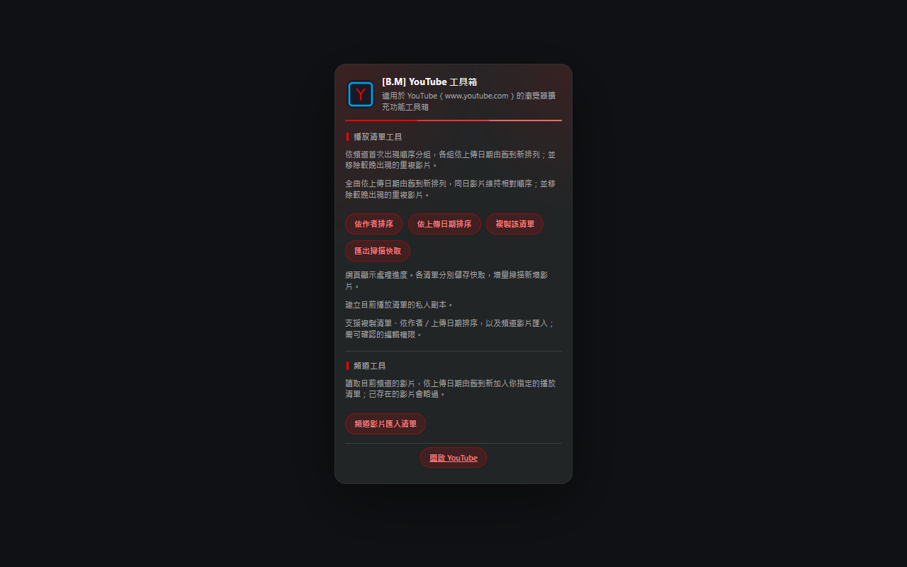

# [B.M] YouTube 工具箱

[](https://developer.chrome.com/docs/extensions/mv3/)
[](https://www.youtube.com)
[](https://github.com/BoringMan314/bm-youtube-tool)
[](https://github.com/BoringMan314/bm-youtube-tool/releases)
[](LICENSE)

適用於 [YouTube](https://www.youtube.com)（`www.youtube.com`）的瀏覽器擴充功能工具箱：播放清單排序／複製，以及將目前頻道影片依上傳日期由舊到新匯入自己的清單。

*适用于 YouTube（`www.youtube.com`）的浏览器扩展工具箱。*<br>
*YouTube（`www.youtube.com`）向けのブラウザー拡張機能ツールボックス。*<br>
*A browser extension toolbox for YouTube (`www.youtube.com`).*

> **聲明**：本專案為第三方輔助工具，與 YouTube／Google 官方無關。使用請遵守該站服務條款與著作權規範。排序與匯入使用網站內部 API，可能隨網站改版失效。

---



---

## 目錄

- [功能](#功能)
- [系統需求](#系統需求)
- [安裝方式](#安裝方式)
- [本機開發與測試](#本機開發與測試)
- [技術概要](#技術概要)
- [專案結構](#專案結構)
- [版本與多語系](#版本與多語系)
- [隱私說明](#隱私說明)
- [維護者：更新 GitHub 與 Chrome 線上應用程式商店](#維護者更新-github-與-chrome-線上應用程式商店)
- [授權](#授權)
- [問題與建議](#問題與建議)

---

## 功能

### 播放清單工具

需開啟可編輯的一般播放清單（`list=PL…`）：

- **依作者排序**：按上傳頻道首次出現順序分組，頻道內依上傳日期由舊到新；並移除較晚出現的重複影片。
- **依上傳日期排序**：全曲依上傳日期由舊到新；同日保留相對順序；並移除較晚出現的重複影片。
- **複製該清單**：建立私人副本，保留順序與重複項目，不排序。
- **匯出掃描快取**：手動另存 JSON；日常進度存在 `chrome.storage.local`。

### 頻道工具

需開啟頻道頁、`/videos` 分頁或影片觀看頁：

- **頻道影片匯入清單**：讀取目前頻道影片，依上傳日期**舊→新**加入目標清單；已存在的 `videoId` 略過。
- 目標清單可**貼上 PL…／網址**（記住上次），或**新建私人清單**（名稱可改，預設頻道名）。

關閉工具列彈出面板不會中斷網頁面板；重新整理或關閉分頁會停止，下次可接續。

---

## 系統需求

- **Chrome** 或 **Microsoft Edge**（Chromium）等支援 **Manifest V3** 的瀏覽器。
- 須已登入 YouTube，且對目標清單具可確認的編輯權限。

---

## 安裝方式

### 從原始碼載入（開發人員模式）

1. 點選本頁綠色 **Code** → **Download ZIP** 解壓，或執行 `git clone https://github.com/BoringMan314/bm-youtube-tool.git` 複製本倉庫。
2. 以 **Chrome** 或 **Microsoft Edge** 開啟 `chrome://extensions`（在 Edge 為 `edge://extensions`）。
3. 開啟「**開發人員模式**」→「**載入未封裝項目**」→ 選取含 [`manifest.json`](manifest.json) 的**專案根目錄**（勿選子資料夾）。
4. 開啟 YouTube 播放清單或頻道頁，點工具列圖示操作；修改程式後請先**重新載入**擴充功能再重新整理分頁。

---

## 本機開發與測試

```powershell
node verification/sorter-check.cjs
node verification/channel-import-check.cjs
```

修改 [`src/`](src/) 或 popup 後，在 `chrome://extensions` 將本擴充**重新載入**，再重新整理 YouTube 分頁驗證。

---

## 技術概要

- **彈出面板** [`popup.html`](popup.html)／[`popup.js`](popup.js)：啟動各功能並帶入 i18n 字串。
- **隔離世界橋接** [`src/feature-playlist-sort-storage.js`](src/feature-playlist-sort-storage.js)：僅暴露排序／匯入用的 `chrome.storage.local` 鍵。
- **頁面脈絡注入** [`src/injected-playlist-sorter.js`](src/injected-playlist-sorter.js)、[`src/injected-channel-import.js`](src/injected-channel-import.js)：以目前分頁登入狀態呼叫同站 Innertube API（讀取、移動、刪除重複、加入影片）。
- 權限：`storage`、`scripting`、`activeTab`、`downloads`。無常駐內容腳本、無背景服務。

---

## 專案結構

| 路徑 | 說明 |
|------|------|
| [`manifest.json`](manifest.json) | Manifest V3 設定 |
| [`popup.html`](popup.html)／[`popup.js`](popup.js)／[`popup.css`](popup.css) | 工具列彈出面板 |
| [`src/feature-*.js`](src/) | 彈出面板功能入口 |
| [`src/injected-*.js`](src/) | 注入 YouTube 頁面的處理面板 |
| [`_locales/`](_locales/) | 多語系字串（`zh_TW`、`zh_CN`、`ja`、`en_US`） |
| [`icons/`](icons/) | 工具列圖示 |
| [`verification/`](verification/) | 模擬 API 驗證腳本 |
| [`privacy-policy.html`](privacy-policy.html) | 隱私權政策 |

---

## 版本與多語系

- **版本**：以 [`manifest.json`](manifest.json) 的 `version` 為準。
- **預設語系**：`zh_TW`（`default_locale`）。
- **內建語系**：`zh_TW`、`zh_CN`、`ja`、`en_US`。

---

## 隱私說明

本擴充**不蒐集、不上傳**可識別個人之帳戶或瀏覽內容至開發者伺服器；驗證請求僅以目前分頁的登入 Cookie 對 YouTube 同站發出，**不**把憑證寫入匯出的快取 JSON。詳見 [`privacy-policy.html`](privacy-policy.html)。

**上架提醒**：若上架 Chrome Web Store，須在開發人員後台完成隱私實踐聲明，並提供隱私權政策的公開 HTTPS 網址。
---

## 維護者：更新 GitHub 與 Chrome 線上應用程式商店

### 更新至 GitHub

**Bash / Git Bash / PowerShell：**

```powershell
git add .
git commit -m "docs: 更新內容說明與商店連結"
git push origin main
```

### 更新至 Chrome 線上應用程式商店

請透過 [Chrome Web Store 開發人員控制台](https://chrome.google.com/webstore/devconsole) 手動上傳更新：

1. **遞增版本**：修改 `manifest.json` 中的 `version`。
2. **封裝套件**：將專案執行所需檔案壓縮為 ZIP 檔。
   - **必要檔案**：`manifest.json`、`popup.*`、`src/`、`icons/`、`_locales/`、`privacy-policy.html`
   - **建議不打包**：`.git/`、`README.md`、`verification/`、`參考/`、`screenshot/`、`*.psd`、`*.zip`、`*.url`
3. **上傳審核**：在控制台選擇項目 →「套件」→「上傳新套件」。
4. **提交送審**：確認版號、文案、截圖及隱私欄位後，提交送審。

---

## 授權

本專案以 [MIT License](LICENSE) 授權。

---

## 問題與建議

歡迎透過 [GitHub Issues](https://github.com/BoringMan314/bm-youtube-tool/issues) 回報錯誤或提出改善建議。回報時請一併提供瀏覽器版本、介面語言、操作的清單／頻道網址，以及面板上的「停止：」訊息或診斷 JSON。
